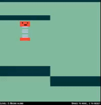
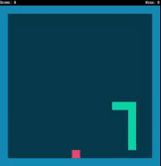
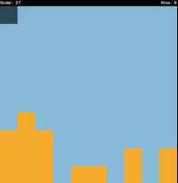
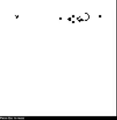
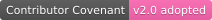

# Smolpxl

Smolpxl is a JavaScript library for writing little retro pixelated games,
and lots of games made with the library.

You can play the games by going to https://smolpxl.artificialworlds.net .

To start learning how to create games, follow the tutorial: [Code your first game in JavaScript](https://www.artificialworlds.net/blog/2020/10/11/code-your-first-game-snake-in-javascript-on-raspberry-pi/).

This page is for learning how to make your own games.

## Writing a game

* Copy [index.html](public/snake/index.html) into a new directory under
  `public/`.
* Create `game.js`, like this:

```javascript
const game = new Smolpxl.Game();
game.setSize(9, 9); // This is how many pixels there are on the screen

function newModel() {
    // The model is the state of your game world.
    // It is held in a JavaScript object, with any properties you like.
    return {
        x: 0,
        y: 8
    };
}

function update(runningGame, model) {
    // This is called every time step.
    // Use it to modify the game model and return the new version.
    // You can get user input and other info from the runningGame object.

    model.x += 1;
    if (model.x >= 10) {
        model.x = 0;
    }

    return model;  // Don't forget this line!
}

function view(screen, model) {
    // This is called after update.
    // Use it to draw your model on the screen.

    // Draw pixels with something like:
    screen.set(model.x, model.y, Smolpxl.colors.WHITE);
    // Or:
    screen.set(0, 0, [32, 128, 255]);

    // Draw ascii-art images with something like:
    screen.draw(2, 2,
        [ "..#..",
          ".###.",
          "#####",
          ".###.",
          "..#.." ],
        { "#": Smolpxl.colors.RED }
    );
}

// Finally, start your game, passing in the beginning model:
game.start("mygame", newModel(), view, update);
```

* Open `index.html` in your web browser.
* If something doesn't work, press F12 and open the browser's Console to see
  whether there are any errors.
* For more details, see the tutorial:
  [Code your first game in JavaScript](https://www.artificialworlds.net/blog/2020/10/11/code-your-first-game-snake-in-javascript-on-raspberry-pi/).
* Smolpxl is still quite new - you will probably need to
  [read the code](public/smolpxl.js) to work out how it works, and study the
  example projects.

## Examples

### Spring

[](https://smolpxl.gitlab.io/smolpxl/spring)
Click the image to play Spring, or
[look at the code of Spring](public/spring/game.js).

### Snake

[](https://smolpxl.gitlab.io/smolpxl/snake)
Click the image to play Snake, or
[look at the code of Snake](public/snake/game.js).

### Heli

[](https://smolpxl.gitlab.io/smolpxl/heli)
Click the image to play Heli, or
[look at the code of Heli](public/heli/game.js).

### Conway's Life

[](https://smolpxl.gitlab.io/smolpxl/life)
Click the image to play Conway's Life, or
[look at the code of Conway's Life](public/life/game.js).

## Extra options

There are various settings you can set on your game.  Examples:

```javascript
const game = new Smolpxl.Game();

// Pixel size of the screen
game.setSize(100, 100);

// The name to display in the browser title
game.setTitle("Rightwaves");

// Colour of the extra screen area
game.setBorderColor([15, 15, 15]);

// Game speed in frames per second
game.setFps(FPS);

// Show the Smolpxl bar at the top (Like, Share, Code)
game.showSmolpxlBar();
game.setSourceCodeUrl("https://gitlab.com/smolpxl/rightwaves");

// Which touch controls to display
game.showControlsLeft(["MENU", "SELECT"]);
game.showControlsMiddle(["ARROWS"]);
game.showControlsRight([{control: "BUTTON1", name: "Fire"}]);

// Allow recording replays of gameplay, and playing back on the title screen.
game.enableReplays();
```

## Anonymous stats

So we can see how popular the games are, the library can submit an anonymous
HTTP request every time someone plays a game.

If you copy the code of an example game, remove the line
`game.sendPopularityStats();` to prevent attempting to send statistics.

## Web site code

The code for https://smolpxl.artificialworlds.net is at
https://gitlab.com/smolpxl/smolpxl-website .

## License and credits

Copyright 2020 Andy Balaam and contributors, released under the
[AGPLv3 license](LICENSE) or later.

Contains icons from the
[Feather Icons](https://github.com/feathericons/feather) set, which is
Copyright 2013-2017 Cole Bemis, and released under the
[MIT License](https://github.com/feathericons/feather/blob/8b5d6802fa8fd1eb3924b465ff718d2fa8d61efe/LICENSE).

Uses [shareon](https://shareon.js.org/) by Nikita Karamov to provide the
social sharing buttons.  (The code is dynamically loaded when the Share button
is clicked.)

Images in Duckmaze 2 are by [Raory](https://github.com/Raory).

Some levels in Duckmaze 2 are by Jean-Michel Baudrey.

## Code of conduct

Please note that this project is released with a
[Contributor Code of Conduct](code_of_conduct.md).  By participating in this
project you agree to abide by its terms.

[](code_of_conduct.md)
